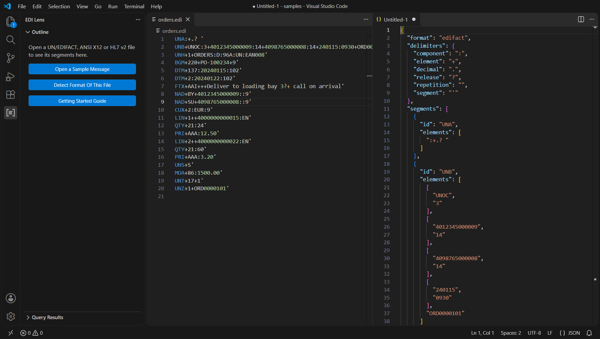
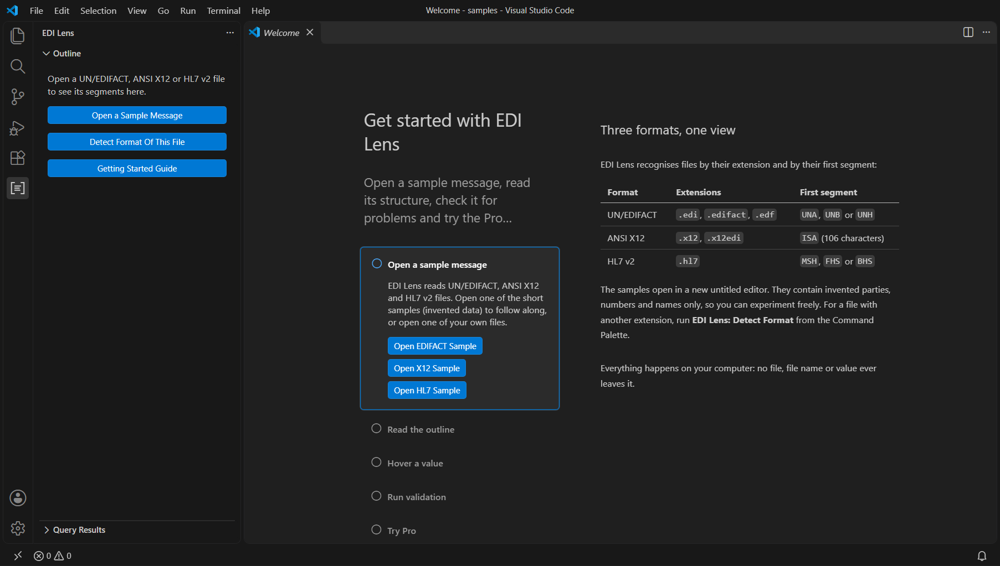
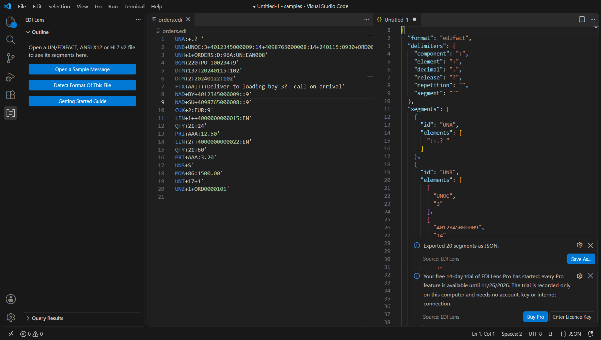
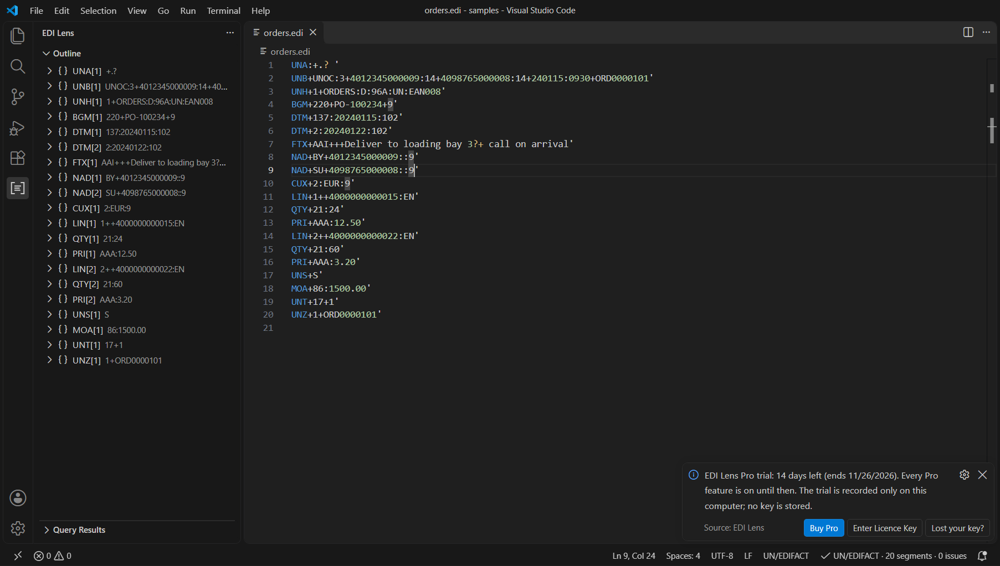
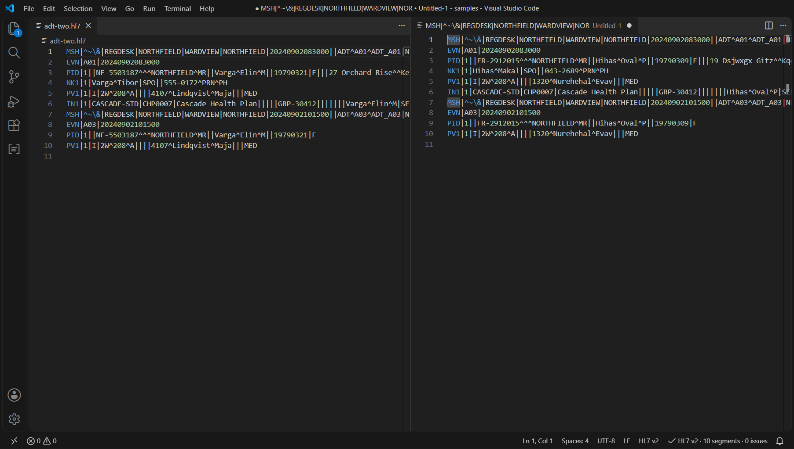
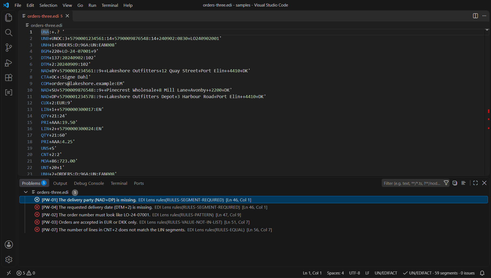
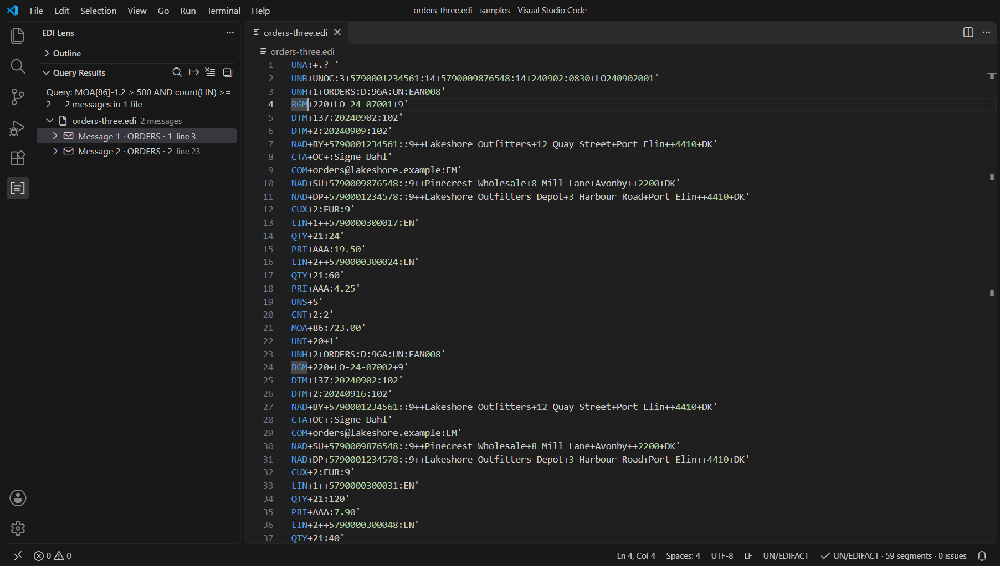
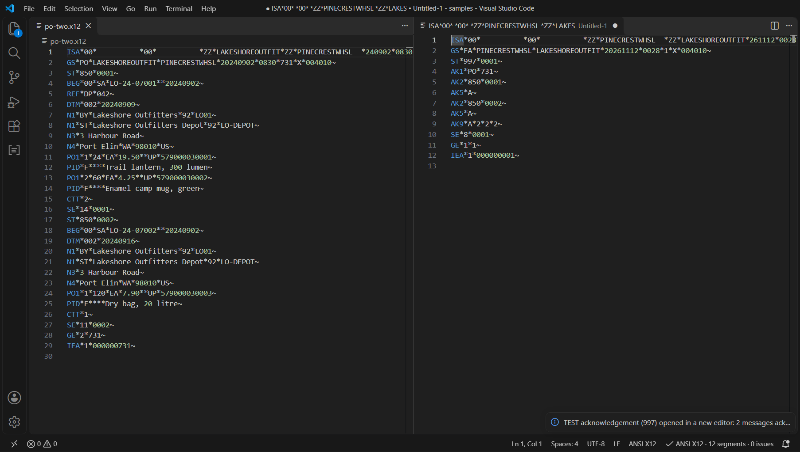
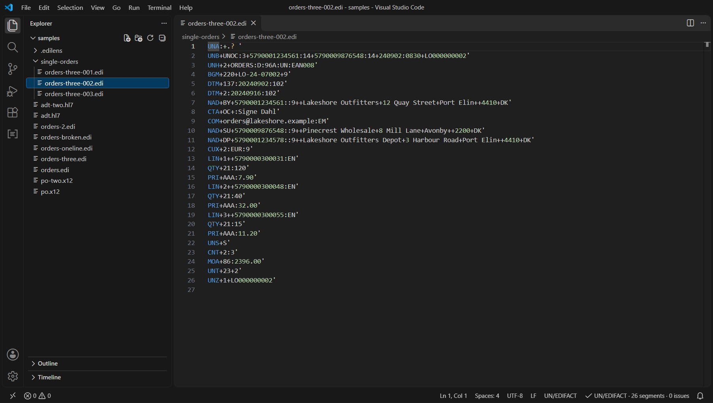

# EDI Lens

**Read, check, reformat, compare, query, anonymise and split UN/EDIFACT, ANSI X12 and HL7 v2 messages in VS Code.** A file that arrives as one long line becomes readable in one command; every value has a path you can copy; wrong segment counts, control numbers and envelopes show up as problems in the editor. Everything runs on your computer, with no telemetry and no account.

EDI Lens is made for integration engineers, analysts and support staff who open these files every day. The free features cover reading, checking and formatting. **Pro** adds the tools for files from partners: anonymised copies with the identifying values replaced, validation against your own partner rules, a query over whole folders, and split, merge, renumber and test acknowledgements, next to comparison, export, workspace-wide checks, dictionaries and batch formatting. The first Pro command you run starts a free **14-day trial**, and a one-time licence key keeps Pro afterwards.

## Screenshots

Outline, hover and status bar on a UN/EDIFACT order:


Problems in a file whose segment count and control references do not match:


One long line, after **EDI Lens: Pretty Print**:


The outline for ANSI X12 and HL7 v2:


Compare With Another File (Pro), Export As JSON (Pro), the walkthrough and the licence status:










The Pro tools for partner files (anonymise, partner rules, query, acknowledgement and split) are shown with their descriptions [below](#anonymise-message-and-anonymise-folder-pro).

## Free, trial and Pro

| Feature | Free | Trial (14 days) | Pro |
| --- | :---: | :---: | :---: |
| Syntax colouring for UN/EDIFACT, ANSI X12 and HL7 v2 | yes | yes | yes |
| Detect Format and automatic language switch | yes | yes | yes |
| Outline view: segment, element, component tree, click to reveal, copy path | yes | yes | yes |
| Hover: path, raw value, position, length | yes | yes | yes |
| Pretty Print, Minify and Format Document | yes | yes | yes |
| Go to Segment, Copy Path At Cursor, Jump To Matching Trailer | yes | yes | yes |
| Structural validation with stable problem codes (on open, save and while typing) | yes | yes | yes |
| Status bar: format, segment count, issue count | yes | yes | yes |
| Walkthrough, sample messages, Report A Problem | yes | yes | yes |
| Compare With Another File (segment and element level differences) | | yes | yes |
| Export As JSON, CSV or XML | | yes | yes |
| Validate Workspace with a Markdown report | | yes | yes |
| Load Dictionary: names in hovers and in the outline | | yes | yes |
| Batch Pretty Print Folder | | yes | yes |
| Anonymise Message and Anonymise Folder: copies with the identifying values replaced, structure and validity kept | | yes | yes |
| Partner rules: validate against your own implementation guide, create rules from a message, folder report as HTML and CSV | | yes | yes |
| Query: find messages by their content in a file or a folder, saved queries, CSV export | | yes | yes |
| Envelope tools: split, merge, renumber control numbers, test acknowledgement (997, 999, CONTRL, ACK) | | yes | yes |

* **Free** needs no key, no account and no network connection, and these features will not be moved behind the key later.
* **Trial**: the first Pro command you run starts a free 14-day trial of every Pro feature on this computer. It is recorded only in the editor's storage on that computer (nothing is sent anywhere) and needs no key or account. **EDI Lens: Show Licence Status** shows the days left; a reminder appears at most once a day. When the trial ends, the free features keep working and the next Pro command shows **Buy Pro** and **Enter Licence Key**.
* **Pro** is a one-time payment, not a subscription, in two licence types with the same features (see [Pricing](#pricing)). **EDI Lens: Buy Pro** opens the checkout page, the key arrives by e-mail, **EDI Lens: Enter Licence Key** activates it. One key is for one person on up to three computers and never expires. Pro is sold outside the Visual Studio Marketplace.

## Pricing

| | Pro Personal | Pro Business |
| --- | --- | --- |
| Price | USD 29, once | USD 59 per user, once |
| For | One person who pays for the licence themselves. Use at work is allowed. | Companies and other organisations that pay for the people who use Pro. |
| Keys | One key | One key per user: set the number of users with the Buy command, or add ?quantity=N to the checkout link. |
| Computers | Up to three computers per key | Up to three computers per key |
| Moving a key | To another computer of yours, with **Remove Licence From This Machine** | To another computer or to a colleague in the same organisation, with **Remove Licence From This Machine** |
| Features, expiry | All Pro features; the key never expires | All Pro features; the key never expires |

Prices are those at the time of writing; the checkout page shows the final price and any taxes for your country. **EDI Lens: Buy Pro** asks which licence you want and, for Business, for the number of users (1 to 100), then opens the checkout page. Payments and invoices are handled by Dodo Payments, the payment provider and merchant of record. Reselling or sharing a key outside your organisation is not allowed; see [LICENSE.txt](LICENSE.txt) and [TERMS.md](TERMS.md).

## Quick start

1. Install **EDI Lens** from the Extensions view (`Ctrl+Shift+X`; publisher ImadMuratspahic). Requires VS Code 1.82 or newer.
2. Open a `.edi`, `.x12` or `.hl7` file, or run **EDI Lens: Open Sample EDIFACT** for a sample with invented data. For other extensions run **EDI Lens: Detect Format**.
3. Click the EDI Lens icon in the activity bar for the outline; hover a value for its path; check the status bar for the segment and problem counts.
4. **EDI Lens: Pretty Print** (or `Shift+Alt+F`) for one segment per line.
5. **Help > Welcome > Get started with EDI Lens** walks through the rest in six steps.

More: [Getting started](docs/getting-started.md), [Formats and checks](docs/formats.md), [Anonymise](docs/anonymise.md), [Partner rules](docs/partner-rules.md), [Query](docs/query.md), [Envelope tools](docs/envelope-tools.md), [Licence, trial and Pro](docs/licence.md), [Troubleshooting](docs/troubleshooting.md), [Changelog](CHANGELOG.md).

## Supported formats and what is validated

| Format | Recognised by | Delimiters |
| --- | --- | --- |
| UN/EDIFACT | `UNA`, `UNB` or `UNH` at the start; `.edi`, `.edifact`, `.edf` | From the `UNA` service string advice when present, otherwise `+ : ' ?`. The release character is honoured: an escaped delimiter is data. |
| ANSI X12 | `ISA` at the start (106 characters); `.x12`, `.x12edi` | From the fixed-width `ISA`: element separator, component separator, segment terminator (a line break is accepted), repetition separator. |
| HL7 v2 | `MSH`, `FHS` or `BHS` at the start; `.hl7` | From `MSH`: field separator and the four (or five) encoding characters. Segments end with CR, LF or CRLF. |

Validation is **structural**. Every problem has a stable code (for example `X12-SE-COUNT`) and points at the exact characters; the complete list with meanings is in [docs/formats.md](docs/formats.md).

| Format | Checks |
| --- | --- |
| UN/EDIFACT | `UNB` first and `UNZ` last; `UNH`/`UNT` pairs; `UNT` segment count and message reference; `UNZ` message count and interchange reference; `UNG`/`UNE` pairs, counts and references; syntax identifier and control reference present; segment ids; unclosed release characters; messages without body segments. |
| ANSI X12 | `ISA` is exactly 106 characters; `ISA`/`IEA`, `GS`/`GE`, `ST`/`SE` nesting; `SE` segment count and control number; `GE` transaction set count and control number; `IEA` group count and control number; `ISA16` present; duplicate control numbers; empty transaction sets; segment ids. |
| HL7 v2 | First segment `MSH` (or `FHS`/`BHS`); field separator and encoding characters well formed; `MSH-9` message type, `MSH-10` control id and `MSH-12` version present; segment ids; blank lines; `FHS`/`FTS` and `BHS`/`BTS` batch counts. |

This built-in validation does not check a message against a message-type specification or a code list, and EDI Lens ships no names for segments or elements (load your own dictionary for that, see below). Checks against your own implementation guide are what [partner rules](#partner-rules-pro) are for: you write the rules, EDI Lens applies them.

## Features in detail

### Outline view

The **EDI Lens** icon in the activity bar opens the outline of the active file: segment, element, component and, where they exist, repetition and subcomponent. Segments are labelled like `NAD[2]` (the second `NAD`) with a preview of the value. Select an item to jump to it; right-click and choose **Copy Path**. Empty elements are left out; the numbers in the labels keep their real positions. The outline refreshes a moment after you stop typing and lists up to 20,000 segments.

### Paths

Every item has a path `SEG[occurrence]-element(repetition).component.subcomponent`, for example `NAD[2]-3.1`, `PID[1]-13(2).1` or `MSH[1]-9.2`. Everything after `SEG[n]` is optional, the repetition defaults to 1, numbers are 1-based as in the standards. For HL7 `MSH`, field 1 is the field separator itself and field 2 the encoding characters. Hover, outline, Copy Path, the CSV export and the comparison report use the same paths.

### Hover

Point at any part of a segment to see its path, raw value, position (element, repetition, component, subcomponent) and length in Unicode code points. With a dictionary loaded (Pro) the hover also shows the names of the segment, element, component and code value. Setting `ediLens.hover.enabled` switches it off.

### Formatting

* **EDI Lens: Pretty Print** puts one segment per line. A `UNA` line stays first; every segment keeps its own terminator.
* **EDI Lens: Minify** removes the line breaks between segments. HL7 segments keep the carriage return, which is the HL7 segment terminator (the editor shows it as a line break).
* **Format Document** (`Shift+Alt+F`) does the same as Pretty Print.
* Both only change white space between segments. The values are never touched.

### Navigation

* **EDI Lens: Go to Segment** lists every segment (type `NAD` or `NAD[2]` to filter) and previews the position while you move through the list.
* **EDI Lens: Copy Path At Cursor** copies the shortest path that names the item under the cursor.
* **EDI Lens: Jump To Matching Trailer** moves between `UNB`/`UNZ`, `UNG`/`UNE`, `UNH`/`UNT`, `ISA`/`IEA`, `GS`/`GE`, `ST`/`SE`, `FHS`/`FTS` and `BHS`/`BTS`, in both directions.

### Validation

The structure of each file is checked when you open it, when you save it and, unless you turn it off, a moment after you stop typing. Problems appear in the editor and in the Problems view with a stable code and the exact range. Syntax problems found while reading (an unterminated segment, a bad `ISA`) are reported alongside. **EDI Lens: Validate Current File** checks on demand, also for files above the automatic size limit.

### Compare With Another File (Pro)

Choose another open file or browse for one. Segments are aligned by a longest common subsequence over their ids, then differences are listed down to element, component and subcomponent with their paths, in a side-by-side view. Use `ediLens.compare.ignoreSegments` and `ediLens.compare.ignorePaths` (with `*` as wildcard) to leave out control numbers and dates, and `ediLens.compare.ignoreCase` and `ediLens.compare.trimValues` for case and white space. Both files must be in the same format. Very large comparisons list at most 3,000 rows and leave out unchanged segments.

### Export (Pro)

**Export As JSON**, **CSV** or **XML** opens the result in a new editor, from where you save it.

* **JSON** has the shape `{ "format": ..., "delimiters": {...}, "segments": [ { "id": "NAD", "elements": [...] } ] }`. An element is a string when it has one repetition with one component with one subcomponent; otherwise an array of components (a component with subcomponents is an array of strings), and an element with several repetitions is `{ "repetitions": [...] }`. Values are the raw text from the file.
* **CSV** has the header `segment,occurrence,path,value`, one row per element or component (per subcomponent where a component is split), RFC 4180 quoting and `CRLF` line ends. **Values that start with `=`, `+`, `-`, `@`, a tab or a carriage return get a leading apostrophe**, so a spreadsheet does not run them as formulas (setting `ediLens.export.neutraliseFormulas`, on by default; turn it off for the exact values, for example negative amounts).
* **XML** is generic and well formed: `<message format="...">` containing `<s_NAD id="NAD" n="1">` with `<e03>`, `<c01>` and `<u01>` children. All five XML special characters are escaped.

### Validate Workspace (Pro)

Scans the folders of the workspace, parses and validates every matching file and opens a Markdown report. The issues also appear in the Problems view (clear them with **EDI Lens: Clear Workspace Validation Results**). Files are found by the glob in `ediLens.workspace.include`; files without a matching extension are also looked at by their first bytes. Limits: 2,000 files per scan, 5 MB per file; larger files are listed as skipped. The scan can be cancelled from the progress notification.

### Load Dictionary (Pro)

EDI Lens does not ship names for segments or elements: those come from standards that are licensed separately. If you have your own descriptions, put them in a JSON file and load it with **EDI Lens: Load Dictionary**. The choice is remembered for the workspace; **EDI Lens: Unload Dictionary** removes it.

```json
{
  "format": "edifact",
  "name": "My partner profile",
  "segments": {
    "BGM": {
      "name": "Beginning of message",
      "elements": {
        "1": {
          "name": "Document name",
          "components": { "1": "Document name code" },
          "values": { "220": "Order" }
        }
      }
    }
  }
}
```

`format` is `edifact`, `x12` or `hl7`; the dictionary is used for files of that format. Limits: 2 MB of text, 2,000 segment definitions, 100,000 entries. The file is only read as JSON; nothing in it is executed.

### Batch Pretty Print Folder (Pro)

Right-click a folder in the Explorer (or run the command and pick a workspace folder). EDI Lens counts the matching files and asks for confirmation. **Nothing is written without it.** Each file is parsed, reformatted with one segment per line and written back with its original line ending style and byte order mark. A file is only rewritten after a check that its data is identical once minified. Files that are not valid UTF-8, contain no segments or are larger than 5 MB are skipped. There is no undo for files written to disk, so use version control or a backup for folders you care about.

### Selectors: the paths used by rules and queries

Anonymise rules, partner rules and queries name values with a **selector**. It looks like a path, with one difference: the brackets hold a **qualifier**, not a count.

| Selector | Meaning |
| --- | --- |
| `NAD` | every `NAD` segment |
| `NAD[BY]` | the `NAD` segments whose first element (its first component) is `BY`; also `NM1[IL]`, `DTM[137]`, `QTY[21]` |
| `NM1[IL\|QC]` | one of several qualifiers; `*` is a wildcard |
| `OBX[3.1=2345-7]` | the qualifier sits in element 3, component 1 |
| `LIN#2` | the second `LIN` of the message |
| `NAD[BY]-2.1` | element 2, component 1 of those segments |
| `PID-5` | the whole element; `PID-5.1` one component; `PID-3.4.2` a subcomponent; `PID-13(2).1` only the second repetition |

Results always show the hover path (`NAD[2]-2.1`), so you can jump to the value or copy it.

### Anonymise Message and Anonymise Folder (Pro)

Support and test teams cannot paste real messages into tickets or test systems. **EDI Lens: Anonymise Message** opens a copy of the open file in which the identifying values are replaced; **Anonymise Folder** writes copies of every message file of a folder into a new folder next to it (`<folder>-anonymised`). The original files are never changed.



* **The structure stays valid.** Only the values named by a rule are replaced, each by a value of exactly the same length made of letters and digits where the original had letters and digits. Every delimiter, escape sequence, segment and count stays where it was, so the copy has the same problems (or none) as the original. Control numbers, counts, delimiters, message types and versions in the envelope are protected and never replaced.
* **Actions:** `mask` (letters become `X`, digits `9`), `pseudonym` (other letters and digits), `fake-name` (reads like a name), `fake-date` (the date moves by a number of days that is the same for the whole run, so the order of dates is kept; both dates of a range such as `20240101-20240131` move), `keep` (leave as it is) and `blank` (empty the value; the only action that changes a length).
* **Consistent.** The same original value always becomes the same replacement inside a run, so a patient or party that appears in several places or files still matches. Give a **seed** when asked and a later run with the same seed gives the same replacements; leave it empty and a random seed is used for that run only.
* **Built-in profiles** (setting `ediLens.anonymise.profiles`): `hl7-patient` (the main identifying fields of `PID`, `NK1`, `IN1`, `GT1`), `x12-healthcare` (the main identifying fields of 837, 835, 270 and 271: `NM1` of subscriber, patient and dependent, `N3`, `N4`, `DMG`, member and claim numbers, `PER`), `x12-party` (`N1`, `N2`, `N3`, `N4`, `PER` of any transaction, for example orders and invoices) and `edifact-party` (`NAD`, `CTA`, `COM`, `FII`). A profile replaces exactly the paths listed in [docs/anonymise.md](docs/anonymise.md), not every field that could identify somebody: other segments (for example `PV1`, `OBX`, `NTE`, `REF`, `RFF`, `FTX`, dates of service) stay unless you add rules for them.
* **Sender and receiver of the envelope.** The party ids in `UNB`, `UNG`, `ISA06`, `ISA08`, `GS02`, `GS03` and `MSH-3` to `MSH-6` are replaced too (setting `ediLens.anonymise.envelopeIds`, default `pseudonymise`), with the same replacement the id gets in the body, so the first segment of a copy does not name the parties. Set it to `keep` when a test system must still route the copy by these ids.
* **A file in which no rule matched is not anonymised, and EDI Lens says so.** Anonymise Message then makes no copy and tells you why. Anonymise Folder does not write such a file into the target folder; it lists it as "unchanged: no rule matched" in the report and shows a warning with the count (setting `ediLens.anonymise.copyUnchanged` copies these files unchanged if you want a complete folder).
* **Your own rules** go into `.edilens/anonymise.json` in the workspace folder (setting `ediLens.anonymise.rulesFile`); the editor checks the file against a JSON schema while you type. Your rules come before the profiles.

```json
{
  "profiles": ["hl7-patient"],
  "rules": [
    { "format": "hl7", "path": "PV1-7", "action": "fake-name" },
    { "format": "x12", "path": "NM1[IL]-9", "action": "mask" },
    { "format": "edifact", "path": "NAD[BY]-2.1", "action": "keep" }
  ]
}
```

* **The report lists counts only**, per rule and per file, never a value. The table of originals and replacements exists only in memory and is gone when the window closes. **EDI Lens: Export Pseudonym Map** writes it to a file of your choice, after a warning that this file is as sensitive as the original messages.
* **What it does not do.** Only the values named by rules are replaced. Free text (notes, comments, descriptions) is not searched for names, and a field that your partner uses in an unusual way is not recognised. Read the copy before you share it. A pseudonym is not encryption: short values can collide, and somebody who knows the seed and guesses an original can confirm the guess. Whether a copy is anonymous in the legal sense depends on what else it contains and on who receives it. File names are kept as they are.

Details and every profile path: [docs/anonymise.md](docs/anonymise.md).

### Partner rules (Pro)

Structural validation is the same for everybody; every partner also has an implementation guide. Write that guide as a rule file `.edilens/rules.json` (setting `ediLens.rules.file`) and **EDI Lens: Validate With Partner Rules** shows every violation as a problem in the editor, with the rule id and the message from your file. **Validate Folder With Partner Rules** checks a whole folder with progress and a cancel button, opens an HTML report and offers it as HTML or CSV.



```json
{
  "name": "Harbor Supply purchase orders",
  "format": "edifact",
  "messageTypes": ["ORDERS"],
  "rules": [
    { "id": "HS-01", "type": "segment-required", "segment": "NAD[DP]", "message": "The delivery party (NAD+DP) is missing." },
    { "id": "HS-02", "type": "value-in", "path": "BGM-1.1", "values": ["220", "221"] },
    { "id": "HS-03", "type": "pattern", "path": "BGM-2", "pattern": "^PO-\\d{2}-\\d{5}$" },
    { "id": "HS-04", "type": "segment-required", "segment": "QTY[21]", "within": "LIN" },
    { "id": "HS-05", "type": "condition", "if": { "path": "BGM-1.1", "equals": "220" }, "then": { "type": "segment-required", "segment": "DTM[2]" } },
    { "id": "HS-06", "type": "equal", "left": "count(LIN)", "right": "CNT[2]-1.2" }
  ]
}
```

Rule types: `segment-required`, `segment-forbidden`, `occurrences` (min, max), `element-required`, `value-in` (a code list), `pattern` (a regular expression), `range`, `date` (for example `CCYYMMDD`), `length`, `condition` (if A then B) and `equal` (two values, `count(...)` or `sum(...)`, for totals). Rules are checked once per message; with `"within": "LIN"` once per group. A pattern that could take very long (nested repetitions, backreferences, lookarounds) is refused when the file is loaded. The violations of a file are removed when you edit it; run the command again for a fresh list.

**EDI Lens: Create Rules From This Message** writes a starting rule file from a message you know is good: the segments it has, the elements that are always filled and the code values it uses. It describes one file, so review it before you rely on it. Rule violations are listed separately from the structural problems; **EDI Lens: Clear Partner Rules Results** removes them. Every rule type and problem code: [docs/partner-rules.md](docs/partner-rules.md).

### Query (Pro)

**EDI Lens: Query** finds the messages that satisfy a condition, in the open file or in a whole folder: "which messages have this order number", "all invoices of this buyer above 1000".



```
NAD[BY]-2.1 == "5412*" AND count(LIN) > 2
MOA[86]-1.2 > 1000 AND NOT exists(CTA)
PID-5.1 == "Hartwell" OR sum(FT1-12) >= 2500
```

Compare a value with a text in quotes (`*` is a wildcard; a text is compared as text, so `"12345"` does not match `0012345`) or with a number using `==`, `!=`, `<`, `<=`, `>`, `>=`; numbers are compared exactly however long they are, so an 18-digit identifier never matches its neighbour; use `count(...)`, `sum(...)` and `exists(...)`; combine with `AND`, `OR`, `NOT` and brackets. A condition is checked once per message (`UNH` to `UNT`, `ST` to `SE`, or an `MSH` with its segments). The matches appear in the **Query Results** view under the EDI Lens icon with file, message number, line and the matched values; select one to jump to it. A query can be saved under a name for the workspace (**EDI Lens: Delete Saved Query** removes one), the results can be exported with **EDI Lens: Export Query Results As CSV**, and **EDI Lens: Clear Query Results** empties the view. A folder search shows progress, can be cancelled, reads one file at a time and lists at most `ediLens.query.maxResults` messages. The language in full: [docs/query.md](docs/query.md).

### Envelope tools (Pro)



* **EDI Lens: Split Interchange Into Messages** writes every message of the open file into its own file (`name-001.edi`, `name-002.edi`, ...) in a folder you choose. Each file has a complete envelope copied from the source with a fresh control number and correct counts; an HL7 message stands on its own. The open file is not changed.
* **EDI Lens: Merge Messages Into One Interchange** takes the files you select (or a folder from the Explorer) and opens one interchange in a new editor: the envelope of the first file, every X12 and EDIFACT message renumbered so that the references are unique, the trailer counts correct. HL7 messages are wrapped in a batch (`BHS` ... `BTS`) and keep their own control ids. All files must be in the same format and use the same delimiters.
* **EDI Lens: Renumber Control Numbers** renumbers interchange, group and message control numbers of the open file from a start value, headers and trailers together. You choose whether the numbers quoted by acknowledgement segments in the same file (`AK1`, `AK2`, `TA1`, `UCI`, `UCF`, `UCM`, `MSA`) stay as they are or follow.
* **EDI Lens: Generate Acknowledgement** opens a basic acknowledgement for the open file: an X12 `997` (or `999`, setting `ediLens.envelope.x12Acknowledgement`), an EDIFACT `CONTRL` or an HL7 `ACK`. Sender and receiver are swapped and the control numbers of the source are quoted. **It is a test acknowledgement and is marked as one** (`ISA15` is `T`, the `UNB` test indicator is `1`, `MSH-11` is `T`): a message counts as accepted when its envelope is closed and its count and reference agree, which is not a business decision. A group or interchange whose own trailer is missing or wrong is never reported as accepted. Do not send it as a production acknowledgement.



A file whose envelope is damaged is refused by Split and Merge with the reason, instead of producing half a result. Details and problem codes: [docs/envelope-tools.md](docs/envelope-tools.md).

## Commands

| Command | Tier |
| --- | :---: |
| EDI Lens: Detect Format | Free |
| EDI Lens: Pretty Print | Free |
| EDI Lens: Minify | Free |
| EDI Lens: Go to Segment | Free |
| EDI Lens: Copy Path At Cursor | Free |
| EDI Lens: Jump To Matching Trailer | Free |
| EDI Lens: Validate Current File | Free |
| EDI Lens: Open Sample EDIFACT / Open Sample X12 / Open Sample HL7 | Free |
| EDI Lens: Open Getting Started Guide | Free |
| EDI Lens: Show Documentation | Free |
| EDI Lens: Report A Problem | Free |
| EDI Lens: Unload Dictionary | Free |
| EDI Lens: Clear Workspace Validation Results | Free |
| EDI Lens: Clear Partner Rules Results | Free |
| EDI Lens: Clear Query Results | Free |
| EDI Lens: Delete Saved Query | Free |
| EDI Lens: Buy Pro | Free |
| EDI Lens: Enter Licence Key | Free |
| EDI Lens: Show Licence Status | Free |
| EDI Lens: Remove Licence From This Machine | Free |
| EDI Lens: Compare With Another File | Pro |
| EDI Lens: Export As JSON | Pro |
| EDI Lens: Export As CSV | Pro |
| EDI Lens: Export As XML | Pro |
| EDI Lens: Validate Workspace | Pro |
| EDI Lens: Load Dictionary | Pro |
| EDI Lens: Batch Pretty Print Folder | Pro |
| EDI Lens: Anonymise Message | Pro |
| EDI Lens: Anonymise Folder | Pro |
| EDI Lens: Export Pseudonym Map | Pro |
| EDI Lens: Validate With Partner Rules | Pro |
| EDI Lens: Create Rules From This Message | Pro |
| EDI Lens: Validate Folder With Partner Rules | Pro |
| EDI Lens: Query | Pro |
| EDI Lens: Export Query Results As CSV | Pro |
| EDI Lens: Split Interchange Into Messages | Pro |
| EDI Lens: Merge Messages Into One Interchange | Pro |
| EDI Lens: Renumber Control Numbers | Pro |
| EDI Lens: Generate Acknowledgement | Pro |

The editor context menu of EDI Lens languages has an **EDI Lens** submenu; the Explorer folder menu offers **Batch Pretty Print Folder**, **Anonymise Folder**, **Validate Folder With Partner Rules**, **Query** and **Merge Messages Into One Interchange**. No keyboard shortcuts are assigned by default; add your own in the Keyboard Shortcuts editor.

## Settings

| Setting | Default | Description |
| --- | --- | --- |
| `ediLens.validateOnType` | `true` | Check the structure while you type, after a short pause. When off, files are checked on open and save. Files above 2 MB are only re-checked on save. |
| `ediLens.maxFileSizeMB` | `10` | Largest file parsed automatically (outline, hover, status bar, problems). Larger files are checked on demand with **Validate Current File**. |
| `ediLens.maxIssues` | `500` | Maximum number of problems reported per file. |
| `ediLens.hover.enabled` | `true` | Show hover information. |
| `ediLens.autoDetectLanguage` | `true` | Switch a file that opens as one of the three languages to the one its content shows (for example an X12 file named `.edi`). A language you choose by hand is left alone for the rest of the session. |
| `ediLens.workspace.include` | `**/*.{edi,edifact,edf,x12,x12edi,hl7}` | Files used by Validate Workspace and Batch Pretty Print Folder. |
| `ediLens.workspace.exclude` | `**/{node_modules,.git,.hg,.svn}/**` | Files and folders the workspace features skip. |
| `ediLens.compare.ignoreSegments` | `[]` | Segment ids left out of a comparison. |
| `ediLens.compare.ignorePaths` | `[]` | Paths left out of a comparison; `*` matches any characters. |
| `ediLens.compare.ignoreCase` | `false` | Ignore case when comparing. |
| `ediLens.compare.trimValues` | `false` | Ignore leading and trailing spaces when comparing. |
| `ediLens.export.neutraliseFormulas` | `true` | In CSV exports, prefix values that start with `=`, `+`, `-`, `@`, a tab or a carriage return with an apostrophe so spreadsheets do not run them as formulas. |
| `ediLens.anonymise.profiles` | all four | Built-in rule sets for Anonymise: `hl7-patient`, `x12-healthcare`, `x12-party`, `edifact-party`. |
| `ediLens.anonymise.envelopeIds` | `pseudonymise` | What Anonymise does with the sender and receiver ids of the envelope: `pseudonymise` replaces them like the same id in the body, `keep` leaves them (for copies a test system must still route). |
| `ediLens.anonymise.copyUnchanged` | `false` | Anonymise Folder does not write files in which no rule matched; turn this on to copy them unchanged as well. They are listed as unchanged either way. |
| `ediLens.anonymise.rulesFile` | `.edilens/anonymise.json` | Rule file for Anonymise, inside the workspace folder or an absolute path. Optional. |
| `ediLens.rules.file` | `.edilens/rules.json` | Partner rule file, inside the workspace folder or an absolute path. |
| `ediLens.query.ignoreCase` | `false` | Ignore case when Query compares text. |
| `ediLens.query.maxResults` | `1000` | Largest number of matching messages Query lists in one run (at most 10,000). |
| `ediLens.envelope.startNumber` | `1` | First control number for Split, Merge and Generate Acknowledgement, and the value offered by Renumber Control Numbers. |
| `ediLens.envelope.x12Acknowledgement` | `997` | Transaction set that Generate Acknowledgement writes for an X12 file: `997` or `999`. |

## FAQ

**What does Pro include?** Anonymise Message and Folder, partner rules, Query, the envelope tools (split, merge, renumber, test acknowledgement), Compare With Another File, Export As JSON/CSV/XML, Validate Workspace, Load Dictionary and Batch Pretty Print Folder. Everything else is free and stays free.

**What does it cost?** One payment: Pro Personal USD 29, Pro Business USD 59 per user, at the time of writing (the checkout page shows the final price and taxes for your country). No subscription, no renewal.

**Personal or Business?** Personal is for one person who pays with their own money; you may use it at work. Business is for a company or other organisation that pays for its staff or contractors. One key per user: set the number of users with the Buy command, or add ?quantity=N to the checkout link. A Business key belongs to the organisation and can be moved to a colleague: run **Remove Licence From This Machine** on the computers of the previous user, then enter the key on the new user's computer. Both types unlock exactly the same features.

**Can we pay by purchase order, or get a quote or a contract?** No. Pro is sold only through the online checkout of the payment provider, which issues the invoice. Purchase orders, invoices with payment terms, custom contracts and vendor or security questionnaires are not offered. The facts an IT or procurement team usually asks for are in [For IT and procurement](#for-it-and-procurement).

**On how many computers?** One key is for one person on up to three computers at the same time, for both licence types. **Does the key expire?** No; it covers every update of EDI Lens.

**Can I try before buying?** Yes, twice over: the free features let you read, check and format without any key, and the first Pro command you run starts a free 14-day trial of every Pro feature on this computer. No key, account or network is needed for the trial.

**How do I move the licence to another computer?** Run **EDI Lens: Remove Licence From This Machine** on the old computer (this frees one activation), then **Enter Licence Key** on the new one. If the old computer is gone, contact support so the activation can be released.

**What happens offline?** The free features and the trial need no network at all. A licence is checked with the licence server at most once a day; if the server cannot be reached, the last successful check keeps Pro working for 14 days (**Show Licence Status** tells you until when). After that, Pro waits for the next successful check; the key stays stored.

**What data is sent?** Only the licence check, only after you enter a key: the key, the label `VS Code on <platform>` and the activation id. Never file contents, file names, user or computer names. There is no telemetry. See [Privacy](#privacy).

**I lost my key.** It was e-mailed by the payment provider right after the purchase; search that mailbox and its spam folder for "Dodo Payments" or "EDI Lens". Your purchases are also listed in the payment provider's customer portal. Still lost: contact support (never post the key itself in a public issue). The **Lost your key?** button in **Show Licence Status** repeats these steps.

**Which VS Code versions and editors?** VS Code 1.82 or newer. The extension is plain JavaScript without platform-specific parts and is meant to run on Windows, macOS and Linux; this version was tested on Windows with VS Code 1.146. Editors built on the same extension interface run it as well; where no credential store exists, the key cannot be saved and the activation is released again with a clear message.

**Does it work in remote workspaces (SSH, WSL, containers)?** Yes. The extension runs on the remote side, so the licence check is sent from the remote machine. The licence key and the trial record are kept by the editor's own storage, which VS Code holds on your local computer.

## Troubleshooting

* **The file is not recognised.** The first non-blank characters must be `UNA`, `UNB`, `UNH`, a 106-character `ISA`, `MSH`, `FHS` or `BHS`. For other file extensions run **EDI Lens: Detect Format** or add a `files.associations` setting.
* **"file over limit" in the status bar.** The file is larger than `ediLens.maxFileSizeMB`; run **Validate Current File** or raise the setting.
* **Pretty Print changes nothing.** The file is already one segment per line, or its segment terminator is itself a line break.
* **A Pro command shows the Pro message although you have a key.** Run **Show Licence Status**; it names the exact state and offers **Enter Licence Key** and **Lost your key?**.
* **Activation fails.** The message names the reason (unknown key, key not active, activation limit, no connection, no credential store) and the next step; details in [docs/licence.md](docs/licence.md).
* **Anything else:** [docs/troubleshooting.md](docs/troubleshooting.md), then **EDI Lens: Report A Problem**.

## Limits and good to know

* **Built-in checks are structural.** No validation against message-type specifications or code lists comes with the extension, and no names for segments or elements unless you load your own dictionary. Partner rules (Pro) check what you write into your own rule file.
* **Anonymise replaces what its rules name.** It does not search free text for names, and a pseudonym is not encryption. Read a copy before you share it.
* **Acknowledgements are test acknowledgements.** They are basic, marked as tests and based only on the envelope checks; they do not replace the acknowledgement of a production system.
* **Syntax colouring assumes the default delimiters** (`+ : ' ?` for UN/EDIFACT, `* : > ~` for X12, `| ^ ~ \ &` for HL7). Colouring cannot follow delimiters that a file defines for itself; everything else (outline, hover, validation, formatting) uses the delimiters the file declares.
* **Size.** Files up to 10 MB (setting) are parsed automatically; a 5 MB file parses in well under two seconds and a 50 MB file can be checked on demand. Typing-time checks pause for files above 2 MB. Workspace scans read at most 5 MB per file and 2,000 files. Anonymise, partner rules, Query and Renumber read a file segment by segment, so a 50 MB file is worked through with well under 1 GB of memory; their folder runs read at most 2,000 files, each up to `ediLens.maxFileSizeMB`. Split and Generate Acknowledgement accept up to 200,000 messages in one file.
* **Encoding.** Files are expected to be UTF-8. Batch Pretty Print Folder skips any file that is not valid UTF-8 rather than risk changing its characters.
* **Virtual workspaces.** Single-file features work everywhere. The folder commands (Validate Workspace, Batch Pretty Print Folder, Anonymise Folder, Validate Folder With Partner Rules, Query over a folder) need a folder on a normal file system.
* **Untrusted workspaces.** All features are available. Files are only written where you confirm it or choose the place: Batch Pretty Print Folder, Anonymise Folder, Split Interchange Into Messages, Export Pseudonym Map and the saved reports. Rule files are read as JSON only; nothing in them is executed, and patterns that could take very long are refused.

## Privacy

EDI Lens has no telemetry and sends none of your files or file names anywhere. Parsing, validation, comparison, export, anonymising, partner rules, queries, the envelope tools and the trial all happen locally.

The only network request is the licence check of the Pro tier, and it is only made after you have entered a licence key. It sends the licence key and the text `VS Code on <platform>` (for example `VS Code on Windows`; never your computer's name) to the licence service of the payment provider, to activate, validate or deactivate the key. A successful check is remembered for 24 hours, and if the service cannot be reached the last successful check keeps Pro working for 14 days. Without a licence key the extension makes no network requests at all. The licence key is stored in VS Code's secret storage; the trial record lives in the editor's extension storage of this computer. The full statement is in [PRIVACY.md](PRIVACY.md).

Data disclosure for the licence check:

* **When it happens.** After you enter a key, when you run **Enter Licence Key**, **Show Licence Status** or **Remove Licence From This Machine** (you start these), and also on its own, at your next use of a Pro feature once the last successful check is older than 24 hours (this includes the start of the editor when a dictionary is remembered for the workspace). Entering a key that is already active here only validates it. **Report A Problem** never contacts the licence service. Never without a key; never for the free features or the trial.
* **What is sent.** The licence key, the label `VS Code on <platform>` (activation only), and the activation id the service returned (validation and deactivation). Nothing else: no file contents, file names, user name, computer name, workspace path or usage statistics. The service also sees your IP address, as any web service does.
* **Who receives it.** Dodo Payments, the payment provider and merchant of record that sold the key, at `live.dodopayments.com`. The data is not sent to the author or to any other third party.
* **Where it goes and how long it is kept.** The provider may process data in several countries and keeps it as long as its own privacy policy states: <https://dodopayments.com/legal/privacy-policy>. The extension keeps the key, the activation id and the id of the product the key belongs to (Personal or Business) only on your machine, until you remove the licence. The answer to an activation also names the buyer; the extension does not keep the name, the e-mail address or anything else from it.
* **Anonymity.** Not anonymous: a licence key belongs to a purchase and therefore to the buyer's record at the payment provider. The platform label contains no personal data.

## For IT and procurement

* **Identity.** The extension id is `ImadMuratspahic.edi-lens` (publisher ImadMuratspahic), for allow lists. The source code is public: <https://github.com/ImadMuratspahic/edi-lens>.
* **Network.** One host, `live.dodopayments.com`, used only for the licence check and only after a key was entered. No setting can point the extension at another host. No telemetry, no file or file name leaves the computer. The free features and the 14-day trial make no network request at all. Details: [Privacy](#privacy) and [PRIVACY.md](PRIVACY.md).
* **Offline.** A successful licence check is trusted for 24 hours; without a connection the last successful check keeps Pro working for 14 days. There is no offline licence for computers that are never connected.
* **Licences.** Pro Business: One key per user: set the number of users with the Buy command, or add ?quantity=N to the checkout link. Each key works on up to three computers of its user and can be moved to a colleague with **Remove Licence From This Machine**. The checkout link for N users is `https://checkout.dodopayments.com/buy/pdt_0NrkGSyl3UXB82kEhwUxy?quantity=N`.
* **Buying.** Only through the online checkout of Dodo Payments, the merchant of record, which issues the invoice. Not offered: purchase orders, invoices with payment terms, custom contracts, vendor or security questionnaires.
* **What it installs.** JavaScript only, no bundled third-party components, no binaries, no background service. It runs in the extension host of the editor (on the remote side in remote workspaces).

## Names

UN/EDIFACT, ANSI X12 and HL7 are names of standards that belong to their respective organisations. HL7 is a registered trademark of Health Level Seven International; X12 and ASC X12 are registered trademarks of ASC X12; ANSI is a trademark of the American National Standards Institute. The names are used here only to say which file formats the extension reads. EDI Lens contains no text, tables, code lists or schemas from any of these standards. It is an independent product and is not affiliated with, approved by or endorsed by any of these organisations.

## Support

Questions, bug reports and requests: <https://github.com/ImadMuratspahic/edi-lens/issues>. In the editor, **EDI Lens: Report A Problem** copies a diagnostics block (versions, platform, settings, licence state; no file contents, no key) and opens that page. More about the project: <https://imadmuratspahic-dev.carrd.co>. When you report a problem, please describe it with an example that contains no real business or patient data, and never post a licence key.

## Licence and terms

The free features may be used without charge; Pro features need a paid licence key (Personal or Business) after the trial. See [LICENSE.txt](LICENSE.txt) and [TERMS.md](TERMS.md). Purchases are processed by the payment provider as merchant of record; its buyer terms apply to payment and refunds.
