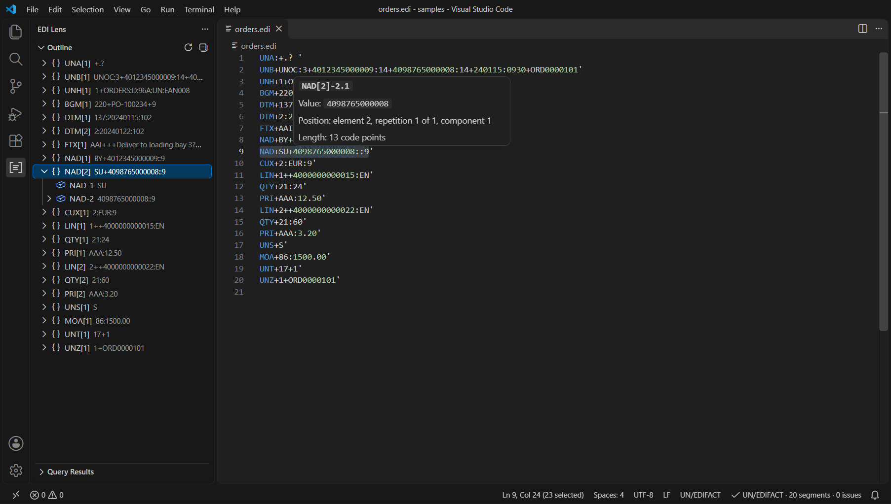
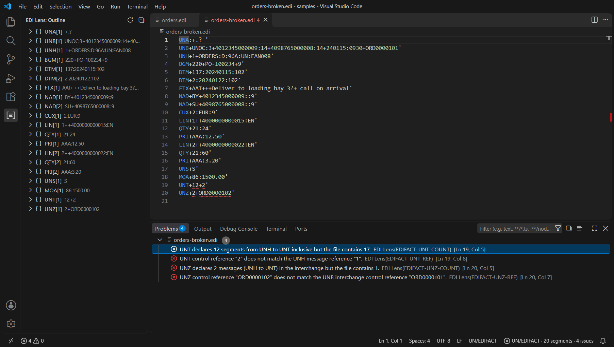
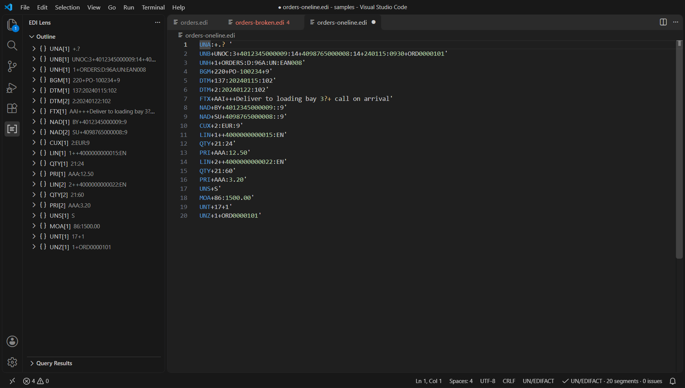
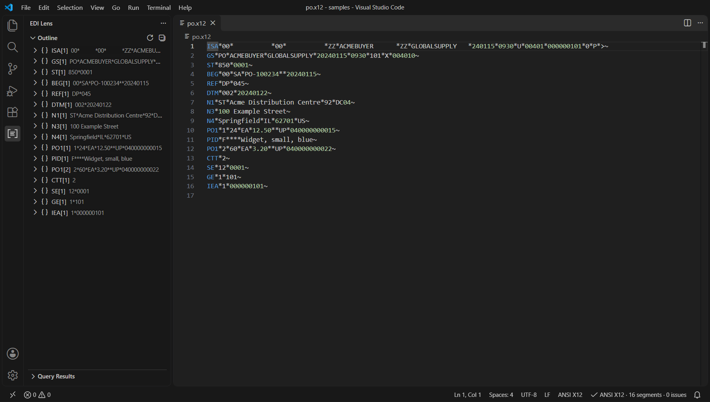
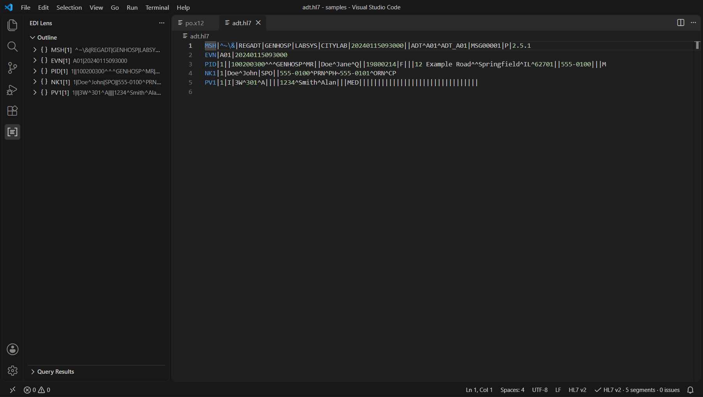
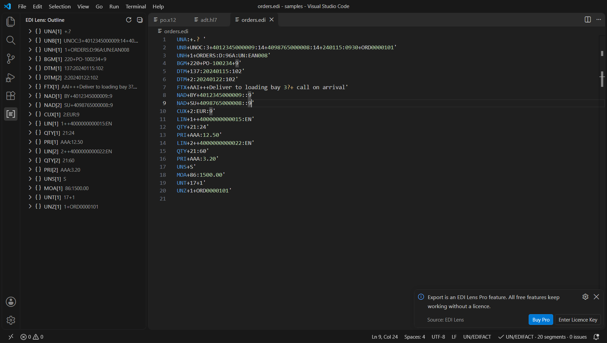
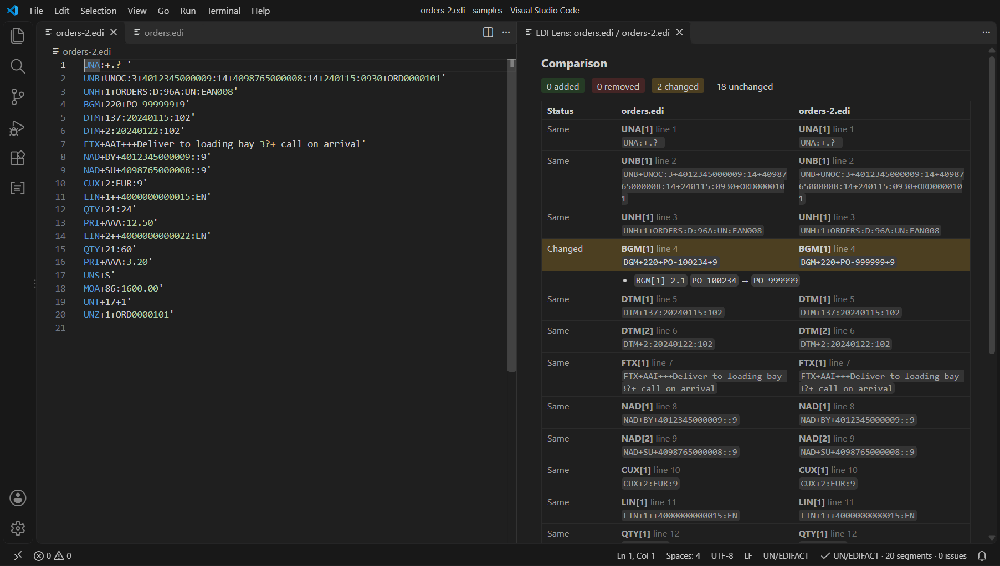

# EDI Lens

Read, check, reformat and compare segment-based business messages in VS Code: **UN/EDIFACT**, **ANSI X12** and **HL7 v2** (pipe-delimited).

EDI Lens is made for integration engineers and analysts who open these files every day. A file that arrives as one long line becomes readable in one command, every item has a path you can copy, and structural mistakes (a wrong segment count, a control number that does not match, a missing trailer) show up as problems in the editor.

Everything runs on your machine. There is no telemetry. The only network request the extension ever makes is the licence check for the optional Pro tier (see [Privacy](#privacy)).

## Screenshots

Outline, hover and status bar on a UN/EDIFACT order:



Structural problems found in a file whose segment count and control references do not match:



A file that arrives as one long line, after **EDI Lens: Pretty Print**:



The same outline for ANSI X12 and HL7 v2:





## Free and Pro

The free tier is complete for everyday reading, checking and formatting. Pro adds comparison, export, workspace-wide checks and names from your own dictionaries.

| Feature | Free | Pro |
| --- | :---: | :---: |
| Syntax colouring for UN/EDIFACT, ANSI X12 and HL7 v2 | yes | yes |
| Detect Format and automatic language switch when the content is clearly another format | yes | yes |
| Outline view: segment, element, component tree with value previews, click to reveal, copy path | yes | yes |
| Hover: path, raw value, position, length | yes | yes |
| Pretty Print, Minify and Format Document | yes | yes |
| Go to Segment, Copy Path At Cursor, Jump To Matching Trailer | yes | yes |
| Structural validation as problems (on open, save and while typing) | yes | yes |
| Status bar: format, segment count, issue count | yes | yes |
| Compare With Another File (segment and element level differences) | | yes |
| Export As JSON, CSV or XML | | yes |
| Validate Workspace with a Markdown report | | yes |
| Load Dictionary: names in hovers and in the outline | | yes |
| Batch Pretty Print Folder | | yes |

**EDI Lens is free to install and use. The Pro features are sold separately, outside the Visual Studio Marketplace.** Pro is a one-time payment (USD 29 at the time of writing; the checkout page shows the final price and any taxes for your country), not a subscription. Pro is unlocked with a licence key that you buy once on the checkout page opened by **EDI Lens: Buy Pro**. A key can be active on a limited number of machines; **EDI Lens: Remove Licence From This Machine** frees an activation. Pro features show a single clear message with **Buy Pro** and **Enter Licence Key** buttons when no valid licence is present. Nothing nags you otherwise.



## Installation

1. Open the Extensions view in VS Code (`Ctrl+Shift+X`).
2. Search for **EDI Lens** (publisher ImadMuratspahic) and select **Install**.
3. Open a file. Files with the extensions `.edi`, `.edifact`, `.edf` (UN/EDIFACT), `.x12`, `.x12edi` (ANSI X12) or `.hl7` (HL7 v2) are recognised automatically. For any other file, run **EDI Lens: Detect Format** from the Command Palette.

Requires VS Code 1.82 or newer.

## What you get

### Formats

| Format | Recognised by | Delimiters |
| --- | --- | --- |
| UN/EDIFACT | `UNA`, `UNB` or `UNH` at the start | Taken from the `UNA` service string advice when present, otherwise the defaults `+ : ' ?`. The release character is honoured: an escaped delimiter is not a delimiter. |
| ANSI X12 | `ISA` at the start (at least 106 characters) | Read from the fixed-width `ISA` segment: element separator, component separator, segment terminator, repetition separator. |
| HL7 v2 | `MSH`, `FHS` or `BHS` at the start | Read from `MSH`: field separator and the four encoding characters. Segments end with CR, LF or CRLF. |

A leading byte order mark and leading blank lines are ignored.

### Outline view

The **EDI Lens** icon in the activity bar opens the outline of the active file: segment, then element, then component (and repetition or subcomponent where they exist). Segments are labelled like `NAD[2]` (second `NAD`), followed by a short preview of the value. Select an item to jump to it in the editor; right-click an item and choose **Copy Path**. The outline refreshes 300 ms after you stop typing. Empty elements are left out of the tree; the numbers in the labels keep their real positions.

### Paths

Every item has a path in the form `SEG[occurrence]-element(repetition).component.subcomponent`, for example `NAD[2]-3.1`, `PID[1]-5(2).1` or `MSH[1]-9.2`. Everything after `SEG[n]` is optional and the repetition defaults to 1. Numbers are 1-based as in the standards. For HL7 `MSH`, field 1 is the field separator itself and field 2 holds the encoding characters, as in the HL7 specification.

### Hover

Point at any part of a segment to see its path, raw value, its position (element, repetition, component, subcomponent) and the length in Unicode code points. With a dictionary loaded (Pro) the hover also shows the segment, element, component and code value names.

### Formatting

* **EDI Lens: Pretty Print** puts one segment per line. A `UNA` line stays first. Every segment keeps its own terminator character.
* **EDI Lens: Minify** removes the line breaks between segments. For HL7 the carriage return stays, because it is the HL7 segment terminator; the editor itself shows each carriage return as a line break.
* **Format Document** (`Shift+Alt+F`) does the same as Pretty Print.
* Both only change white space between segments. The values themselves are never touched.

### Navigation

* **EDI Lens: Go to Segment** lists every segment (type `NAD` or `NAD[2]` to filter) and previews the position while you move through the list.
* **EDI Lens: Copy Path At Cursor** copies the shortest path that names the item under the cursor.
* **EDI Lens: Jump To Matching Trailer** moves between the pairs UNB/UNZ, UNG/UNE, UNH/UNT, ISA/IEA, GS/GE, ST/SE, FHS/FTS and BHS/BTS, in both directions.

### Validation

The structure of each file is checked when you open it, when you save it and, unless you turn it off, a moment after you stop typing. Problems appear in the editor and in the Problems view with a stable code such as `X12-SE-COUNT` and the exact range.

| Format | Checks |
| --- | --- |
| UN/EDIFACT | `UNB` first and `UNZ` last; `UNH`/`UNT` pairs; `UNT` segment count and message reference; `UNZ` message count and interchange reference; `UNG`/`UNE` pairs and counts; syntax identifier present; empty segment id; unclosed release character; messages without body segments. |
| ANSI X12 | `ISA` is exactly 106 characters; `ISA`/`IEA`, `GS`/`GE`, `ST`/`SE` nesting; `SE` segment count and control number; `GE` transaction set count and control number; `IEA` group count and control number; `ISA16` present; duplicate control numbers; empty transaction sets. |
| HL7 v2 | First segment is `MSH`; field separator and encoding characters well formed; `MSH-9` message type, `MSH-10` control id and `MSH-12` version present; segment ids of three characters starting with a letter; blank lines; `FHS`/`BHS`/`BTS`/`FTS` batch counts. |

Syntax problems found while reading the file (for example an unterminated segment) are reported alongside. Validation is **structural**: it checks envelopes, counts, control numbers and delimiters. It does not check a message against a message-type specification, an implementation guide or a code list.

### Compare With Another File (Pro)

Choose another open file or browse for one. Segments are aligned by a longest common subsequence over their ids, then differences are listed down to element, component and subcomponent with their paths. Results open in a side-by-side view. Use the settings `ediLens.compare.ignoreSegments` and `ediLens.compare.ignorePaths` (with `*` as wildcard) to leave out control numbers and dates, and `ediLens.compare.ignoreCase` and `ediLens.compare.trimValues` for whitespace and case. Both files must be in the same format. For very large comparisons the view lists at most 3,000 rows and leaves out unchanged segments.



### Export (Pro)

**Export As JSON**, **CSV** or **XML** opens the result in a new editor, from where you can save it.

* **JSON** has the shape `{ "format": ..., "delimiters": {...}, "segments": [ { "id": "NAD", "elements": [...] } ] }`. An element is a string when it has one repetition with one component with one subcomponent. Otherwise it is an array of components (a component with subcomponents is an array of strings), and an element with several repetitions is `{ "repetitions": [...] }`. Values are the raw text from the file.
* **CSV** has the header `segment,occurrence,path,value`, one row per element or component (per subcomponent where a component is split), RFC 4180 quoting and `CRLF` line ends.
* **XML** is generic and well formed: `<message format="...">` containing `<s_NAD id="NAD" n="1">`, with `<e03>`, `<c01>` and `<u01>` children. All five XML special characters are escaped.

### Validate Workspace (Pro)

Scans the folders of the workspace, parses and validates every matching file and opens a Markdown report. The issues also appear in the Problems view (clear them with **EDI Lens: Clear Workspace Validation Results**). Files are found by the glob in `ediLens.workspace.include`; files without a matching extension are also looked at by their first bytes. Limits: 2,000 files per scan, 5 MB per file; larger files are listed as skipped. The scan can be cancelled from the progress notification.

### Load Dictionary (Pro)

EDI Lens does not ship names for segments or elements: those come from standards that are licensed separately. If you have your own descriptions, put them in a JSON file and load it with **EDI Lens: Load Dictionary**. The choice is remembered for the workspace.

```json
{
  "format": "edifact",
  "name": "My partner profile",
  "segments": {
    "BGM": {
      "name": "Beginning of message",
      "elements": {
        "1": {
          "name": "Document name",
          "components": { "1": "Document name code" },
          "values": { "220": "Order" }
        }
      }
    }
  }
}
```

`format` is `edifact`, `x12` or `hl7`; the dictionary is used for files of that format. Limits: 2 MB of text, 2,000 segment definitions, 100,000 entries. The file is only read as JSON; nothing in it is executed.

### Batch Pretty Print Folder (Pro)

Right-click a folder in the Explorer (or run the command and pick a workspace folder). EDI Lens counts the matching files and asks for confirmation. **Nothing is written without it.** Each file is parsed, reformatted with one segment per line, and written back with its original line ending style and byte order mark. A file is only rewritten after a check that its data is identical once minified. Files that are not valid UTF-8, contain no segments or are larger than 5 MB are skipped. The result is summarised at the end. There is no undo for files written to disk, so use version control or a backup for folders you care about.

## Commands

| Command | Tier |
| --- | :---: |
| EDI Lens: Detect Format | Free |
| EDI Lens: Pretty Print | Free |
| EDI Lens: Minify | Free |
| EDI Lens: Go to Segment | Free |
| EDI Lens: Copy Path At Cursor | Free |
| EDI Lens: Jump To Matching Trailer | Free |
| EDI Lens: Validate Current File | Free |
| EDI Lens: Unload Dictionary | Free |
| EDI Lens: Clear Workspace Validation Results | Free |
| EDI Lens: Buy Pro | Free |
| EDI Lens: Enter Licence Key | Free |
| EDI Lens: Show Licence Status | Free |
| EDI Lens: Remove Licence From This Machine | Free |
| EDI Lens: Compare With Another File | Pro |
| EDI Lens: Export As JSON | Pro |
| EDI Lens: Export As CSV | Pro |
| EDI Lens: Export As XML | Pro |
| EDI Lens: Validate Workspace | Pro |
| EDI Lens: Load Dictionary | Pro |
| EDI Lens: Batch Pretty Print Folder | Pro |

The editor context menu of EDI Lens languages has an **EDI Lens** submenu. No keyboard shortcuts are assigned by default; add your own in the Keyboard Shortcuts editor.

## Settings

| Setting | Default | Description |
| --- | --- | --- |
| `ediLens.validateOnType` | `true` | Check the structure while you type, after a short pause. When off, files are checked on open and save. Files above 2 MB are only re-checked on save. |
| `ediLens.maxFileSizeMB` | `10` | Largest file parsed automatically (outline, hover, status bar, problems). Larger files are checked on demand with **Validate Current File**. |
| `ediLens.maxIssues` | `500` | Maximum number of problems reported per file. |
| `ediLens.hover.enabled` | `true` | Show hover information. |
| `ediLens.autoDetectLanguage` | `true` | Switch a file that opens as one of the three languages to the one its content shows (for example an X12 file named `.edi`). A language you choose by hand is left alone for the rest of the session. |
| `ediLens.workspace.include` | `**/*.{edi,edifact,edf,x12,x12edi,hl7}` | Files used by Validate Workspace and Batch Pretty Print Folder. |
| `ediLens.workspace.exclude` | `**/{node_modules,.git,.hg,.svn}/**` | Files and folders the workspace features skip. |
| `ediLens.compare.ignoreSegments` | `[]` | Segment ids left out of a comparison. |
| `ediLens.compare.ignorePaths` | `[]` | Paths left out of a comparison; `*` matches any characters. |
| `ediLens.compare.ignoreCase` | `false` | Ignore case when comparing. |
| `ediLens.compare.trimValues` | `false` | Ignore leading and trailing spaces when comparing. |
| `ediLens.export.neutraliseFormulas` | `false` | In CSV exports, prefix values that start with `=`, `+`, `-` or `@` with an apostrophe so spreadsheets do not run them as formulas. |
| `ediLens.licenceMode` | `live` | Licence server environment. Leave unchanged unless support asks you to change it. |

## Limits and good to know

* **Structural checks only.** There is no validation against message-type specifications, implementation guides or code lists, and no names for segments or elements unless you load your own dictionary.
* **Syntax colouring assumes the default delimiters** (`+ : ' ?` for UN/EDIFACT, `* : > ~` for X12, `| ^ ~ \ &` for HL7). Colouring cannot follow delimiters that a file defines for itself. Everything else (outline, hover, validation, formatting) uses the delimiters the file declares.
* **Size.** Files up to 10 MB (setting) are parsed automatically; a 5 MB file parses in well under two seconds. Typing-time checks pause for files above 2 MB. Workspace scans read at most 5 MB per file and 2,000 files.
* **Encoding.** Files are expected to be UTF-8. Batch Pretty Print Folder skips any file that is not valid UTF-8 rather than risk changing its characters.
* **HL7 line breaks.** VS Code shows each carriage return as a line break, so **Minify** has no visible effect on a single HL7 message in the editor.
* **Virtual workspaces.** Single-file features work everywhere. Validate Workspace and Batch Pretty Print Folder need a folder on a normal file system.
* **Untrusted workspaces.** All features are available; the only files written are those you confirm in Batch Pretty Print Folder.

## Privacy

EDI Lens has no telemetry and sends none of your files or file names anywhere. Parsing, validation, comparison and export all happen locally.

The only network request is the licence check of the Pro tier, and it is only made after you have entered a licence key. It sends the licence key and the text `VS Code on <platform>` (for example `VS Code on Windows`; never your computer's name) to the licence service of the payment provider, to activate, validate or deactivate the key. A successful check is remembered for 24 hours, and if the service cannot be reached the last successful check keeps Pro working for 14 days. Without a licence key the extension makes no network requests at all. The licence key is stored in VS Code's secret storage. The full statement is in [PRIVACY.md](PRIVACY.md).

Data disclosure for the licence check:

* **When it happens.** After you enter a key, when you run **Enter Licence Key**, **Show Licence Status** or **Remove Licence From This Machine** (you start these), and also on its own, at your next use of a Pro feature once the last successful check is older than 24 hours. Never without a key; never for the free features.
* **What is sent.** The licence key, the label `VS Code on <platform>` (activation only), and the activation id the service returned (validation and deactivation). Nothing else: no file contents, file names, user name, computer name, workspace path or usage statistics. The service also sees your IP address, as any web service does.
* **Who receives it.** Dodo Payments, the payment provider and merchant of record that sold the key, at `live.dodopayments.com`. The data is not sent to the author or to any other third party.
* **Where it goes and how long it is kept.** The provider may process data in several countries and keeps it as long as its own privacy policy states: <https://dodopayments.com/legal/privacy-policy>. The extension keeps the key and the activation id only on your machine, until you remove the licence.
* **Anonymity.** Not anonymous: a licence key belongs to a purchase and therefore to the buyer's record at the payment provider. The platform label contains no personal data.

## Names

UN/EDIFACT, ANSI X12 and HL7 are names of standards that belong to their respective organisations. HL7 is a registered trademark of Health Level Seven International; X12 and ASC X12 are registered trademarks of ASC X12; ANSI is a trademark of the American National Standards Institute. The names are used here only to say which file formats the extension reads. EDI Lens contains no text, tables, code lists or schemas from any of these standards. It is an independent product and is not affiliated with, approved by or endorsed by any of these organisations.

## Support

Questions, bug reports and requests: <https://github.com/ImadMuratspahic/edi-lens/issues>. More about the project: <https://imadmuratspahic-dev.carrd.co>. When you report a problem, please describe it with an example that contains no real business or patient data.

## Licence

The free tier may be used without charge; Pro features need a paid licence key. See [LICENSE.txt](LICENSE.txt).
